<!--
  Hail Hydra (hail-hydra-cc): open-source multi-agent toolkit for AI coding CLIs.
  Routes work to each host's cheaper, faster models: Claude Code, Gemini CLI, Codex CLI and GitHub Copilot CLI.
  10 agents, 10 commands, sentinel verification, codebase map, real token tracking. MIT licensed.
-->

<p align="center">
  <a href="https://github.com/AR6420/Hail_Hydra">
    
  </a>
</p>

<h1 align="center">🐉 H Y D R A</h1>

<p align="center">
  <strong>Multi-Headed Speculative Execution for AI Coding CLIs</strong><br/>
  <sub>Claude Code &nbsp;·&nbsp; Gemini CLI &nbsp;·&nbsp; Codex CLI &nbsp;·&nbsp; GitHub Copilot CLI</sub>
</p>

<p align="center">
  <em>"Cut off one head, two more shall take its place."</em><br/>
  <em>Except here — every head is doing your work faster and cheaper.</em>
</p>

<p align="center">
  <a href="https://www.npmjs.com/package/hail-hydra-cc"></a>
  <a href="https://www.npmjs.com/package/hail-hydra-cc"></a>
  <a href="https://github.com/AR6420/Hail_Hydra"></a>
</p>

<p align="center">
  <strong>10 agents &nbsp;·&nbsp; 10 commands &nbsp;·&nbsp; 6 hooks &nbsp;·&nbsp; 4 host CLIs &nbsp;·&nbsp; Codebase map &nbsp;·&nbsp; Real token tracking &nbsp;·&nbsp; Persistent memory</strong>
</p>

**Hail Hydra is a free multi-agent toolkit for Claude Code, Gemini CLI, Codex CLI and GitHub Copilot CLI.** It gives your coding CLI ten specialist agents, called heads. Each head is pinned to the cheapest model that can do its job well. Your main model plans, decides and verifies. The heads explore, run, write and check.

When you invoke it, Hydra typically cuts per-task cost by **about 50%**, and delegated work runs **2 to 3× faster**. Your main model verifies the results, so quality holds.

- **Ten heads, two tiers.** Seven cheap-tier heads (Haiku, Flash-Lite, GPT-6 Luna) for search, tests, docs, git and scans. Three mid-tier heads (Sonnet, Flash, GPT-6 Sol) for code, review and deep checks.
- **Sentinel verification.** After substantial edits, a fast scan checks imports, signatures and dependencies. It escalates to a deep check only when something looks wrong, and it catches about 72% of integration bugs before runtime.
- **Codebase map.** A persistent dependency graph gives instant blast-radius lookups. Sentinel scans become 3 to 5× cheaper.
- **Real receipts.** `/hydra:stats` reads your CLI's own session logs and reports what you actually spent and saved. No AI estimation.
- **Memory that compounds.** Each head remembers your project's conventions, fragile spots and past false alarms across sessions.

One canonical source generates a native payload for each host. Use `/hydra:*` on Claude Code and Gemini CLI, `$hydra-*` skills on Codex CLI, or `/hail-hydra <task>` on Copilot.

```bash
npx hail-hydra-cc@latest
```

<p align="center"><sub>One command. Pick your CLIs, restart, done. <a href="#install">More install options</a></sub></p>

## See it in action

Run `/hydra:stats` at any point in a session. It shows what every tier actually cost, compared with sending the same tokens to your main model:



<sub>Sample session priced at current Claude list prices (Haiku 5.5, Sonnet 5.5, Opus 5.5). Your numbers depend on how often Hydra is invoked.</sub>

## Meet the ten heads



<details>
<summary><b>All ten heads</b></summary>
<br />

| Head | Tier | Role | Personality |
|:-----|:-----|:-----|:------------|
| `hydra-scout` | 🟢 cheap | Codebase exploration, file search, reading, codebase map | *"I've already found it."* |
| `hydra-runner` | 🟢 cheap | Test execution, builds, linting, validation | *"47 passed, 3 failed. Here's why."* |
| `hydra-scribe` | 🟢 cheap | Documentation, READMEs, comments | *"Documented before you finished asking."* |
| `hydra-guard` | 🟢 cheap | Security and quality gate after code changes | *"No secrets. No injection. You're clean."* |
| `hydra-git` | 🟢 cheap | Git: commit, branch, diff, stash, log | *"Committed. Conventional message. Clean diff."* |
| `hydra-sentinel-scan` | 🟢 cheap | Fast integration sweep after code changes | *"Imports check out. Signatures match. Clean."* |
| `hydra-preflight` | 🟢 cheap | Environment detection, version probing, dependency inventory | *"Your PyTorch/CUDA pair is broken. Pin torch==2.7.0."* |
| `hydra-coder` | 🔵 mid | Code implementation, refactoring, features | *"Feature's done. Tests pass."* |
| `hydra-analyst` | 🔵 mid | Code review, debugging, analysis | *"Found 2 critical bugs and an N+1 query."* |
| `hydra-sentinel` | 🔵 mid | Deep integration analysis, only when the scan flags issues | *"2 real issues confirmed. 1 false positive dismissed."* |

**Default models per host**

| Host | Cheap tier | Mid tier | Orchestrator |
|:-----|:-----------|:---------|:-------------|
| Claude Code | Haiku | Sonnet | your main model (Opus) |
| Gemini CLI | `gemini-3.5-flash-lite` | `gemini-3.8-flash` | your main model |
| Codex CLI | `gpt-6-luna` (low effort) | `gpt-6-sol` (medium effort) | your main model |
| GitHub Copilot CLI | `claude-haiku-5.5`, then `gpt-6-luna` | `claude-sonnet-5.5`, then `gpt-5.6-terra` | your selected model |

</details>

<details>
<summary><b>Task routing cheat sheet</b></summary>
<br />

```
Is it read-only? ─── Yes ──→ Finding files?
    │                           ├── Yes: hydra-scout 🟢
    │                           └── No:  hydra-analyst 🔵
    │
    No ──→ Is it a git operation? ─── Yes ──→ hydra-git 🟢
    │
    No ──→ Is it a security scan? ─── Yes ──→ hydra-guard 🟢
    │
    No ──→ Just running a command? ─── Yes ──→ hydra-runner 🟢
    │
    No ──→ Writing docs only? ─── Yes ──→ hydra-scribe 🟢
    │
    No ──→ Clear implementation approach? ─── Yes ──→ hydra-coder 🔵
    │
    No ──→ Needs deep reasoning? ─── Yes ──→ 🧠 orchestrator handles it

    Code was just changed? ─── Yes ──→ hydra-sentinel-scan 🟢
                                            │
                                       Issues found?
                                       ├── No:  Done ✅
                                       └── Yes: hydra-sentinel 🔵
```

</details>

**Use Hydra explicitly when it helps most:**

| Scenario | How to invoke | Why it saves |
|----------|---------------|-------------|
| Broad codebase exploration | "use hydra-scout to find X" | A cheap model reads files faster and for a fraction of the price |
| Multi-file changes | "use hydra-coder to update X across these files" | Parallel mid-tier dispatch beats one sequential frontier run |
| Security review | `/hydra:guard` | Pattern matching runs on the cheap tier |
| Environment validation | `/hydra:preflight` | Probes on the cheap tier, analysis on the mid tier |
| Architecture review | `/hydra:map` | The dependency graph is stored locally |

For one-off questions, simple edits and conversation, your CLI handles the work directly. On Claude Code, Gemini CLI and Codex CLI, Hydra's only automatic step is the sentinel reminder after a substantial edit. Copilot has no automatic step.

## How a task flows



1. **The orchestrator classifies.** Your main model decides what stays with it and what goes to a head. Meanwhile, `hydra-scout` starts gathering relevant files in parallel.
2. **Heads work in waves.** Independent subtasks run at the same time. "Fix the bug and add tests" means two heads working at once.
3. **Everything is checked before you see it.** Raw data and clean passes are auto-accepted. Code and analysis are verified. After substantial edits, sentinel and guard run a verification wave.
4. **You get one answer.** If a head's output isn't good enough, the orchestrator redoes the work itself. Hydra escalates and never downgrades.

<details>
<summary><b>Full architecture</b></summary>
<br />

```
User Request
    │
    ├──────────────────────────────────────────────────────┐
    │                                                      │
    ▼                                                      ▼
┌─────────────────────────────┐            ┌──────────────────────────────┐
│  🧠 ORCHESTRATOR            │            │  🟢 hydra-scout              │
│  Classifies task            │            │  IMMEDIATE pre-dispatch:     │
│  Plans waves                │            │  "Find files relevant to     │
│  Decides blocking / not     │            │   [user's request]"          │
└────────┬────────────────────┘            └──────────────┬───────────────┘
         │         (unless Session Index already covers)  │
         └──────────────────────┬──────────────────────────┘
                                │ (scout + classification both ready)
                      [Session Index updated]
                                │
    ════════════════════════════════════════════════════════
    Wave N  (parallel dispatch, index context injected)
    ┌───────────────────┬──────────────────────────────────┐
    │  SEQUENTIAL       │  PARALLEL (wait for all)         │
    ▼                   ▼                                  │
 [coder]            [scribe] ──────────────────────────────┘
    │
    ▼
 ALL agents complete (orchestrator waits for every dispatched agent)
    │
    ├── Raw data / clean pass? → AUTO-ACCEPT → (updates Session Index if scout)
    └── Code / analysis / user-facing docs? → Orchestrator verifies
         │
         ▼
   ┌─────────────────────────────────────────────────────┐
   │  🛡️ VERIFICATION WAVE (recommended by auto-guard)   │
   │                                                     │
   │  🟢 sentinel-scan — fast integration sweep          │
   │       └── issues? → 🔵 sentinel — deep analysis     │
   │  🟢 guard — security/quality scan                   │
   │                                                     │
   │  Runs before results are presented to you           │
   └──────────────────────┬──────────────────────────────┘
                          │
                          ▼
   User gets result (single response, all agent outputs included)
```

**Design principles**

- **Invisibility.** You should never notice Hydra operating: no announcements, no permission requests, no process narration.
- **Speed over ceremony.** Classification is a quick check ("cheap head, mid head, or me?"). Spending 10 seconds classifying a 5-second task defeats the purpose.
- **Parallel heads.** Independent subtasks launch together.
- **Escalate, never downgrade.** A rejected draft goes back to the orchestrator, never to a retry at the same tier.

</details>

<details>
<summary><b>The theory: speculative decoding at the task level</b></summary>
<br />

Speculative decoding (Chen et al., 2023) speeds up LLM inference. A small **draft model** proposes tokens, and a large **target model** verifies them in parallel. Verifying K tokens costs about the same as generating one, so you get a 2 to 2.5× speedup with **zero quality loss**.

Hydra applies the same idea at the **task level**. Cheap and mid-tier heads draft the task. The orchestrator checks it, then accepts it or redoes it.

| Speculative decoding concept | Hydra equivalent |
|:-----------------------------|:-----------------|
| Target model (large) | 🧠 The orchestrator (Opus / Gemini Pro / GPT-6.1 Sol) |
| Draft model (small) | 🟢🔵 The cheap and mid-tier heads |
| Draft K tokens | Heads draft the full task output |
| Parallel verification | The orchestrator glances at the output |
| Modified rejection sampling | Accept → ship it. Reject → the orchestrator redoes it. |
| Acceptance rate (~70-90%) | Target: 85%+ of delegated tasks accepted as-is |

**Key papers:**
- [Accelerating Large Language Model Decoding with Speculative Sampling](https://arxiv.org/abs/2302.01318), Chen et al., 2023 (DeepMind)
- [Fast Inference from Transformers via Speculative Decoding](https://arxiv.org/abs/2211.17192), Leviathan et al., 2022 (Google)

</details>

## Commands

Ten commands, invoked as `/hydra:*` on Claude Code and Gemini CLI, or as `$hydra-*` skills on Codex CLI. Open a group to see what's inside.

<details>
<summary><b>Everyday</b> (4 commands)</summary>
<ul>
<li><code>/hydra:help</code>: Show all commands and agents</li>
<li><code>/hydra:status</code>: Installed agents, version and update availability</li>
<li><code>/hydra:stats</code>: Real token usage, delegation rate and savings, parsed from the CLI's own session logs</li>
<li><code>/hydra:update</code>: Update Hydra to the latest version</li>
</ul>
</details>
<details>
<summary><b>Verification and safety</b> (3 commands)</summary>
<ul>
<li><code>/hydra:guard [files]</code>: Manual security and quality scan</li>
<li><code>/hydra:map [file | rebuild]</code>: View the codebase dependency map, query a file's blast radius, or rebuild</li>
<li><code>/hydra:preflight</code>: Two-phase environment and compatibility check before a new project build</li>
</ul>
</details>
<details>
<summary><b>Session control</b> (3 commands)</summary>
<ul>
<li><code>/hydra:quiet</code>: Suppress dispatch logs for this session</li>
<li><code>/hydra:stfu</code>: Compress internal thinking for every subagent in the session</li>
<li><code>/hydra:report</code>: Report a bug, request a feature or share feedback</li>
</ul>
</details>
<details>
<summary><b>GitHub Copilot CLI</b> (one opt-in skill)</summary>
<ul>
<li><code>/hail-hydra &lt;task&gt;</code>: Run one task through the Hydra roles on Copilot's native subagents</li>
<li><code>/hail-hydra --mode &lt;turbo|balanced|economy&gt; &lt;task&gt;</code>: Pick speed or cost for this task (default <code>balanced</code>)</li>
<li><code>/hail-hydra --help</code>: Full list, including <code>--compare</code> for measuring savings</li>
</ul>
</details>

<details>
<summary><b><code>/hydra:preflight</code> in detail</b></summary>
<br />

Run it before starting any new project build. It catches broken GPU stacks, missing env vars and incompatible dependency pairs before they cost you hours of debugging. Hydra runs a two-phase check:

1. **Detection** (cheap tier): probes runtimes, the CUDA stack, dependencies, env vars and services.
2. **Analysis** (mid tier): cross-references the results against compatibility matrices and flags each one ✅ COMPATIBLE, ⚠️ KNOWN RISK or ❌ CONFIRMED BREAK.

</details>

## What it saves



<details>
<summary><b>The full math</b></summary>
<br />

| Task type | Share of work | Model used | Input cost vs Opus | Output cost vs Opus |
|:----------|:--------------|:-----------|:-------------------|:--------------------|
| Exploration, search, tests, docs | ~50% | 🟢 Haiku | 2.5% ($0.10 vs $4/MTok) | 2.5% ($0.50 vs $20/MTok) |
| Implementation, review, debugging | ~30% | 🔵 Sonnet | 50% ($2 vs $4/MTok) | 50% ($10 vs $20/MTok) |
| Architecture, hard problems | ~20% | 🧠 Opus | 100% (no change) | 100% (no change) |
| Sentinel scan (fast) | Every code change | 🟢 Haiku | 2.5% | 2.5% |
| Sentinel deep (conditional) | ~20-30% of code changes | 🔵 Sonnet | 50% | 50% |
| **Blended effective cost** | | | **~36% of all-Opus** | **~36% of all-Opus** |

Prices are Haiku 5.5, Sonnet 5.5 and Opus 5.5 (verified 2026-10). Blended input = (0.5×$0.10 + 0.3×$2 + 0.2×$4) / $4 = $1.45/$4 ≈ 36% of all-Opus. Haiku 5.5 prompts over 100K tokens bill at $0.50/$2.50, so sessions heavy on long context save less.

Per-dispatch savings of **about 50% or more** are typical for Hydra-invoked work. Session-level savings depend on how often Hydra is invoked. Run `/hydra:stats` for your real numbers.

On Gemini CLI and Codex CLI the same routing applies against that host's own frontier model. Flash-tier heads are measured against an all-Gemini-Pro baseline. Luna and Sol heads are measured against the session's main GPT model (default GPT-6.1 Sol).

| Metric | Without Hydra | With Hydra |
|:-------|:--------------|:-----------|
| **Task speed (per dispatch)** | 1× | 2–3× faster |
| **API cost (per dispatch)** | 1× | ~0.5× or less |
| **Quality** | Main-model level | Main-model level, verified |
| **Turn 2+ overhead** | Full re-exploration each turn | Session index reused, 2-4 s saved per turn |
| **Integration bugs caught** | None automatically | ~72% before runtime |
| **Sentinel scan tokens** | 3,000-8,000 per scan | 500-1,500 per scan with the codebase map |

</details>

<details>
<summary><b>Why Hydra doesn't hit the subagent cost explosion</b></summary>
<br />

A fair objection to any subagent framework: naive fan-out can cost **3 to 7× more** than a single-thread session. Every spawned agent re-bootstraps context and re-verifies work the orchestrator already understood. Hydra's design avoids that trap on purpose:

- **Bounded, task-scoped dispatch.** One agent per well-defined subtask, with only the context slice it needs. No wide swarm re-reading the repo in parallel.
- **Cheap tiers do the token-heavy work.** The expensive model never pays frontier prices for exploration, test runs or doc writing.
- **`maxTurns` caps on every agent.** A runaway agent stops at 25 turns (cheap tier) or 50 (mid tier) instead of burning tokens indefinitely.
- **The codebase map replaces re-exploration.** Blast-radius lookups cost about 500 to 1,500 tokens instead of a 3,000 to 8,000-token grep sweep.
- **Receipts, not claims.** `/hydra:stats` parses the CLI's own session logs. If dispatch overhead ever ate the savings, the number would show it.

</details>

<details>
<summary><b>Measure it yourself</b></summary>
<br />

1. Start a Claude Code session **without** Hydra installed and complete a representative task.
2. Note the session cost.
3. Start a **new** session **with** Hydra installed and complete a similar task.
4. Compare the two costs, or run `/hydra:stats`.

On Copilot, compare `/usage` before and after a normal run against a `/hail-hydra` run, then run `/hail-hydra --compare`.

</details>

## Install



You need Node.js 16 or newer and at least one supported CLI. Run one command:

```bash
npx hail-hydra-cc@latest
```

The interactive installer lets you pick your CLIs and scope. It deploys the agents, commands, hooks and per-host wiring in seconds. Then use it:

| Host | Invoke with | After install |
|:-----|:------------|:--------------|
| **Claude Code** | `/hydra:help`, `/hydra:stats`, … | Restart Claude Code. The status line and hooks are registered in `~/.claude/settings.json`. |
| **Gemini CLI** | `/hydra:help`, `/hydra:stats`, … | Restart Gemini CLI or run `/commands reload`. |
| **Codex CLI** | `$hydra-help`, `$hydra-stats`, … | **Required once:** run `/hooks` inside Codex to trust the Hydra hooks. They stay inert until then. |
| **GitHub Copilot CLI** | `/hail-hydra <task>` | Run `/skills reload` in the same session. |

<details>
<summary><b>All installer options</b></summary>
<br />

```bash
# Claude Code, all projects, no prompts (v2-compatible default)
npx hail-hydra-cc --global

# Pick your agent(s) explicitly
npx hail-hydra-cc --agent=claude --global
npx hail-hydra-cc --gemini --global
npx hail-hydra-cc --codex --global
npx hail-hydra-cc --copilot --global
npx hail-hydra-cc --agent=claude,gemini,codex,copilot --global

# Every detected agent, fully non-interactive
npx hail-hydra-cc --all --global --yes

# This project only / both scopes
npx hail-hydra-cc --claude --local
npx hail-hydra-cc --claude --both

# Preview what would be written (writes nothing)
npx hail-hydra-cc --dry-run --all

# Check what's deployed
npx hail-hydra-cc --status

# Remove everything
npx hail-hydra-cc --uninstall
```

All flags:
- **Agent selection:** `--agent=<list>` (`claude,gemini,codex,copilot`), or the aliases `--claude`, `--gemini`, `--codex`, `--copilot` and `--all` (every detected agent).
- **Scope:** `--global`, `--local` or `--both`.
- **Non-interactive:** `--yes` (requires an agent selection).
- **Other:** `--dry-run`, `--config-dir <path>` (single agent only), `--status` and `--uninstall`.

</details>

<details>
<summary><b>GitHub Copilot CLI (opt-in)</b></summary>
<br />

Requires a Copilot CLI version that supports skills and explicit invocation.

```bash
npx hail-hydra-cc@latest --copilot --global --yes   # ~/.copilot/skills/hail-hydra (or $COPILOT_HOME)
npx hail-hydra-cc@latest --copilot --local --yes    # .github/skills/hail-hydra, this project only
```

The installer honors `COPILOT_HOME` for the global path. `--config-dir <path>` overrides it; that is Hydra's installer flag, not a Copilot setting.

Then, **inside the same Copilot session**:

```text
/skills reload
/hail-hydra Implement pagination for this API and update the tests
/hail-hydra --mode turbo Build product search and run the relevant checks
/hail-hydra --help
```

`/hail-hydra` is an explicit skill invocation, not a sticky mode. A later message such as `Explain this function` uses the normal agent. The skill sets `disable-model-invocation: false` because some Copilot versions return `Skill not found` for explicit requests otherwise ([copilot-cli#4438](https://github.com/github/copilot-cli/issues/4438)). Accidental model-mediated loading must not trigger Hydra work.

**Model defaults.** Each role dispatches through its tier's `models` list, in order. An admin-disabled or rejected entry falls through to the next one. Your selected main model keeps substantive reasoning and final acceptance. Naming a model in the request overrides the default. Under `Auto`, workers may inherit the session model.

| Tier | Roles | models[0] | fallback | $/1M in/out |
|---|---|---|---|---|
| cheap | git, guard, preflight, runner, scout, scribe, sentinel-scan | `claude-haiku-5.5` | `gpt-6-luna` | 0.10/0.50 · 0.10/0.50 |
| mid | analyst, coder, sentinel, architect, researcher | `claude-sonnet-5.5` | `gpt-5.6-terra` | 2.00/10.00 · 2.00/12.00 |

- **Modes:** `/hail-hydra --mode <turbo|balanced|economy> <goal>` (default `balanced`). Turbo puts speed first and costs more. Ceilings are instruction-level heuristics bounded by your Copilot plan's concurrency, not a scheduler guarantee.
- **Quality:** substantial changes get an automatic in-task review via native `code-review` and `security-review` before completion is reported.
- **Continuity:** treat a `/model` switch like a compaction boundary. Write the session ledger before an anticipated switch, and read it back before the next dispatch or decision.
- **Hooks are deferred** until upstream hook reliability bugs are fixed: copilot-cli issues [#4520](https://github.com/github/copilot-cli/issues/4520), [#1730](https://github.com/github/copilot-cli/issues/1730), [#2201](https://github.com/github/copilot-cli/issues/2201), [#4001](https://github.com/github/copilot-cli/issues/4001) and [#4549](https://github.com/github/copilot-cli/issues/4549). For now, quality gates and `--notify` run in-task or manually.

> **`.claude/` collision:** Copilot also loads a project's `.claude/skills/` and `.claude/agents/`. A repo-local Claude Code Hydra install (`.claude/skills/hydra/`, auto-activating, plus `.claude/agents/hydra-*.md`) will also be visible inside Copilot. In repos where you use `/hail-hydra`, install Claude Hydra globally or remove the local copy.

```bash
npx hail-hydra-cc --copilot --status      # installed version + owned-file count
npx hail-hydra-cc --copilot --uninstall --yes
```

</details>

<details>
<summary><b>What gets installed</b></summary>
<br />

**Claude Code**: `~/.claude/` (or `./.claude/` with `--local`)

```
~/.claude/
├── agents/                      # 10 agent definitions (Haiku/Sonnet pinned, memory: project)
├── commands/hydra/              # slash commands (/hydra:*)
├── hooks/                       # 6 hook scripts + notification sound
│   ├── hydra-check-update.js    # SessionStart: version check (background)
│   ├── hydra-statusline.js      # StatusLine: status bar display
│   ├── hydra-token-math.js      # Token parsing + savings math (shared library)
│   ├── hydra-auto-guard.js      # PostToolUse: file change tracker
│   ├── hydra-notify.js          # Notification: task completion sound
│   ├── hydra-sentinel-done.js   # Sentinel tracking cleanup
│   └── hydra-task-complete.wav  # Notification sound file
└── skills/
    ├── hydra/                   # SKILL.md + VERSION + references/
    └── stfu-agents/             # SKILL.md
```

Hooks and the status line are registered in `~/.claude/settings.json`. Existing entries are preserved, and a custom status line is never overwritten.

**Gemini CLI**: `~/.gemini/` (or `./.gemini/` with `--local`)

```
~/.gemini/
├── agents/                      # 10 agent definitions (Flash-tier pinned)
├── commands/hydra/              # TOML commands (/hydra:*)
├── hydra/                       # SKILL.md, VERSION, references/, hooks/
└── GEMINI.md                    # Hydra marker block (appended, reversible)
```

Hooks (AfterTool, SessionStart, Notification) are registered in `~/.gemini/settings.json`.

**Codex CLI**: `~/.codex/` (or `./.codex/` with `--local`)

```
~/.codex/
├── agents/                      # 10 agent definitions (*.toml, Luna/Sol pinned)
├── hydra/                       # VERSION, references/, hooks/
├── hooks.json                   # Hook registrations; trust once via /hooks
├── config.toml                  # [features] hooks + notify chain (marker blocks, reversible)
└── AGENTS.md                    # Hydra marker block (appended, reversible)
~/.agents/skills/                # Skills: $hydra-help, $hydra-stats, $hydra-guard, …
```

> **Local scope** (`--local`): the per-project payload goes to `./.claude/`, `./.gemini/` or `./.codex/` in your working directory. Hooks and host wiring (settings and hooks registration, context files, Codex skills) always stay user-level.

</details>

## Under the hood

<details>
<summary><b>🛡️ Sentinel: integration integrity</b></summary>
<br />

Most bugs don't come from bad code. They come from good code that **doesn't fit together**: a renamed export, a changed return type, a missing dependency after a refactor. These slip past linters, type-checkers and even code review, because no single file looks wrong.

The auto-guard touchpoint recommends a sentinel scan after every substantial edit. The scan escalates to deep analysis only when it finds something.

```
Code change lands (hydra-coder finishes)
    │
    ▼
┌──────────────────────────────────────┐
│  🟢 hydra-sentinel-scan              │  ← Runs on EVERY code change (~1-2s)
│  Fast sweep: imports, exports,       │
│  signatures, dependencies            │
└──────────────┬───────────────────────┘
               │
          Issues found?
          ├── No:  ✅ Pass, code proceeds to guard
          │
          └── Yes: Escalate
               │
               ▼
┌──────────────────────────────────────┐
│  🔵 hydra-sentinel                   │  ← Only when scan flags issues (~20-30%)
│  Deep analysis: confirms real issues,│
│  dismisses false positives,          │
│  proposes fixes                      │
└──────────────┬───────────────────────┘
               │
          Fix decision:
          ├── Trivial (import typo): Auto-fix
          ├── Medium (signature mismatch): Offer fix to user
          └── Complex (architectural): Report with context
```

| Check type | Priority | Example |
|:-----------|:---------|:--------|
| **Import/export mismatches** | P0 | Importing a function that was renamed or removed |
| **Function signature changes** | P0 | Caller passes 2 args, function now expects 3 |
| **Type contract violations** | P1 | Function returns `string` but caller expects `number` |
| **Missing dependency updates** | P1 | New import added but package not in `package.json` |
| **Cross-file rename gaps** | P1 | Variable renamed in definition but not all call sites |
| **Circular dependency introduction** | P2 | New import creates A → B → C → A cycle |
| **Dead code from refactoring** | P2 | Exported function no longer imported anywhere |
| **Environment/config mismatches** | P2 | Code references env var that isn't in `.env.example` |

```
🛡️ Sentinel Report
──────────────────────────────────────
✖ P0: src/auth.js imports `validateToken` from src/utils.js
       but src/utils.js now exports `verifyToken` (renamed in this session)
       → Fix: Update import to `verifyToken` [auto-fixable]

⚠ P1: src/api/routes.js calls createUser(name, email)
       but src/models/user.js:createUser now expects (name, email, role)
       → Missing required parameter `role` added in this change

✔ 6 other integration points verified clean
──────────────────────────────────────
```

Across these check types, the estimated weighted detection rate is **about 72%** of integration bugs caught before runtime. It is highest for import/export and dependency mismatches (direct matching) and lower for type contracts and config drift (heuristic). Sentinel also remembers past false positives and known fragile points in your project, so it gets more accurate the more you use it.

</details>

<details>
<summary><b>🗺️ Codebase map</b></summary>
<br />

`hydra-scout` builds a persistent dependency map on first run by extracting import statements from every source file with grep. No external parsers are needed. The map is stored at `.claude/hydra/codebase-map.json`.

```
Session 1: scout builds the full map (~10 seconds for 500 files)
Session 2: scout checks git hash → nothing changed → skip rebuild (instant)
Session 3: scout checks git hash → 3 files changed → update only those 3
```

| Data | How it's used |
|:-----|:-------------|
| **File imports** | "auth.ts imports user.ts and env.ts" |
| **Reverse imports** | "auth.ts is imported by users.ts, admin.ts, middleware.ts" |
| **Risk score** | low (0-1 deps) → medium (2-3) → high (4-6) → critical (7+) |
| **Env var index** | "JWT_SECRET is used in auth.ts and middleware.ts" |
| **Test coverage** | covered / partial / untested per file |
| **Git staleness** | Hash comparison for an instant freshness check |

**Without the map**, when `auth.ts` changes, sentinel greps the whole codebase for files that import it. In a 500-file project that takes 5 to 15 seconds and 3,000 to 8,000 tokens. **With the map**, sentinel looks up `imported_by`, gets `[users.ts, admin.ts, middleware.ts]` and reads only those three files. That takes under 2 seconds and 500 to 1,500 tokens.

Risk scores also decide how hard sentinel looks:

| Modified file risk | What happens |
|:-------------------|:------------|
| 🔴 Critical (7+ deps) | Sentinel-scan + deep analysis (always) |
| 🟠 High (4-6 deps) | Sentinel-scan, escalate if issues found |
| 🟡 Medium (2-3 deps) | Sentinel-scan, escalate only for P0 issues |
| 🟢 Low (0-1 deps) | Sentinel-scan, auto-accept if clean |

```bash
/hydra:map                       # Summary: risk distribution, coverage stats
/hydra:map src/services/auth.ts  # Blast radius for a specific file
/hydra:map rebuild               # Force a complete rebuild
```

- Built with grep and regex: no Tree-sitter, no AST parsing, no external dependencies. Works with JS/TS, Python, Go, Java, Kotlin, Ruby and Rust.
- Resolves relative imports (for example `'./auth'` → `src/services/auth.ts`).
- Falls back gracefully. If the map doesn't exist, every agent uses its original grep-based behavior. The map is an optimization, not a requirement.
- Add `.claude/hydra/codebase-map.json` to `.gitignore`; it is machine-generated.

</details>

<details>
<summary><b>🧠 Agent memory</b></summary>
<br />

Without memory, every session starts cold. With memory, knowledge compounds. Every agent has `memory: project` in its frontmatter. Claude Code manages a per-project memory directory (`.claude/memory/`) where agents store and retrieve what they learn.

> Agent memory is a **Claude Code** feature. Gemini CLI and Codex CLI have no equivalent, so the generator drops the `memory` field on those hosts.

| Agent | What it remembers |
|:------|:------------------|
| **hydra-scout** | Project structure patterns, key file locations, search shortcuts |
| **hydra-runner** | Test commands, common failure patterns, build quirks |
| **hydra-scribe** | Documentation style, preferred formats, terminology |
| **hydra-guard** | Known false positives, project-specific security patterns |
| **hydra-git** | Commit conventions, branch naming, merge preferences |
| **hydra-sentinel-scan** | Known fragile integration points, past false positives |
| **hydra-coder** | Coding style, architecture patterns, preferred libraries |
| **hydra-analyst** | Common bug patterns, performance hotspots, review focus areas |
| **hydra-sentinel** | Integration history, confirmed vs dismissed findings |
| **Orchestrator** | Fragile zones, routing accuracy, escalation patterns (in the "Hydra Notes" section of `CLAUDE.md`) |

Memory is automatic, project-scoped and persistent. It is stored as plain markdown in `.claude/memory/`, so you can edit or delete it at any time.

</details>

<details>
<summary><b>🖥️ Status line, completion sound and update notices</b></summary>
<br />

**Status line** (Claude Code only; on other hosts use `/hydra:stats` or `$hydra-stats`):

```
🐉 │ Opus │ Ctx: 37% ████░░░░░░ │ $0.42 │ my-project
```

It shows the current model, context usage with a color bar (green below 50%, yellow 50 to 79%, red 80% and above), the session cost and the working directory. From 70% context it adds a compaction warning:

```
🐉 │ Opus │ Ctx: 73% ███████░░░ │ $1.87 │ my-project │ ⚠ Auto-compact at 85%
🐉 │ Opus │ Ctx: 83% ████████░░ │ $3.14 │ my-project │ ⚠ Compacting soon!
```

If you already have a custom `statusLine`, the installer keeps yours and prints instructions for switching.

**Task completion sound.** Hydra plays a short sound when the CLI finishes responding. It works on macOS (`afplay`), Windows (PowerShell) and Linux (`paplay`/`aplay`), and plays detached so it never delays the response. It is fully event-driven: a Claude Code `Stop` hook, a Gemini `Notification` hook, or a Codex `notify` chain that preserves your existing notifier.

**Update notices.** Hydra checks for updates once per session in the background and never blocks startup:

```
🐉 │ Opus │ Ctx: 37% ████░░░░░░ │ $0.42 │ my-project │ ⚡ v2.6.0 available
```

Update with `/hydra:update` inside the CLI or `npx hail-hydra-cc@latest --global` from your terminal, then restart.

</details>

<details>
<summary><b>⚙️ Configuration</b></summary>
<br />

This applies to Claude Code, Gemini CLI and Codex CLI. Copilot uses a per-task `--mode turbo|balanced|economy` instead. It does not read this config, and it does not treat `aggressive` as an alias for Turbo.

The config file is optional. Create it by hand at your host's config path. The installer doesn't write one, and `--uninstall` leaves it alone.

| Host | Global | Project-level (overrides global) |
|:-----|:-------|:---------------------------------|
| Claude Code | `~/.claude/skills/hydra/config/hydra.config.md` | `.claude/skills/hydra/config/hydra.config.md` |
| Gemini CLI | `~/.gemini/hydra/config/hydra.config.md` | `.gemini/hydra/config/hydra.config.md` |
| Codex CLI | `~/.codex/hydra/config/hydra.config.md` | `.codex/hydra/config/hydra.config.md` |

```markdown
mode: balanced          # conservative | balanced (default) | aggressive
dispatch_log: on        # on (default) | off
auto_guard: on          # on (default) | off
```

Run `/hydra:status` (`$hydra-status` on Codex) to see what's loaded. See [`content/config/hydra.config.md`](content/config/hydra.config.md) for every option.

</details>

<details>
<summary><b>🧩 Add your own head</b></summary>
<br />

1. **Fetch the template** into the agents directory Hydra installed:
   ```bash
   curl -o ~/.claude/agents/hydra-myspecialist.md https://raw.githubusercontent.com/AR6420/Hail_Hydra/main/templates/custom-agent.md
   ```
   For project level, use `.claude/agents/` instead.
2. **Customize it**: edit the name, description, tools and instructions.
3. **Restart your CLI.** The new head is discoverable alongside the built-in ten.

The template uses the Markdown agent format that Claude Code and Gemini CLI (`~/.gemini/agents/`) share. Codex CLI agents live in `~/.codex/agents/` as TOML. See [`templates/custom-agent.md`](templates/custom-agent.md) for guidance on descriptions, output formats and collaboration protocols.

</details>

<details>
<summary><b>📂 Repository structure</b></summary>
<br />

```
hydra/
├── bin/cli.js                        # The npx installer (hail-hydra-cc)
├── content/                          # Canonical source: single origin for every host
│   ├── SKILL.md                      # Orchestrator instructions (full)
│   ├── skill-core.md                 # Compressed core for size-capped hosts
│   ├── agents/                       # 10 agent definitions
│   ├── commands/                     # Command definitions
│   ├── references/                   # Routing guide + model capabilities
│   ├── config/hydra.config.md        # User configuration template
│   └── skills/stfu-agents/           # STFU-Agents skill
├── src/
│   ├── generator/                    # Emitters: content/ → dist/<host>/
│   ├── installer/                    # Multi-host installer
│   ├── hooks/<host>/                 # Per-host lifecycle hooks
│   └── lib/                          # Shared cores (token math, guard, sentinel state)
├── dist/                             # Generated per-host payload (`npm run build`, gitignored)
├── templates/custom-agent.md         # Template for adding your own heads
└── test/                             # Node test suite (`npm test`)
```

</details>

## FAQ

<details>
<summary><b>Will I notice any quality difference?</b></summary>
<br />

No. Hydra only delegates tasks within each model's capability band. If there's any doubt, the task stays with your main model. The orchestrator also verifies the output: if a head's work isn't up to standard, it is redone before you see it.

</details>

<details>
<summary><b>Is this actually speculative decoding?</b></summary>
<br />

Not at the token level; that happens inside the model provider's servers. Hydra applies the same idea at the task level: draft with a fast model, verify with the powerful one, accept or reject. The goals are the same (speed and cost), and so is the guarantee of no quality loss, at a different granularity.

</details>

<details>
<summary><b>What if I'm not using Opus?</b></summary>
<br />

Hydra is designed for the frontier-model-as-orchestrator pattern, but the idea works at any tier. On Gemini CLI and Codex CLI the heads use that host's cheaper models automatically. If Sonnet is your main model on Claude Code, you can point every head at Haiku.

</details>

<details>
<summary><b>Can I change which models the heads use?</b></summary>
<br />

Yes. Each head is a small Markdown file with a <code>model:</code> field in its frontmatter. Change <code>model: haiku</code> to <code>model: sonnet</code> (or any supported model) and you're done.

</details>

<details>
<summary><b>Do the heads work with subagents I already have?</b></summary>
<br />

Yes. Hydra heads coexist with any other subagents. Claude Code discovers every agent in the <code>.claude/agents/</code> directories, so there are no conflicts.

</details>

<details>
<summary><b>Does Sentinel slow things down or auto-fix without asking?</b></summary>
<br />

The fast scan adds about 1 to 2 seconds per code change. The deep analysis runs only when the scan flags issues (about 20 to 30% of changes) and adds another 3 to 5 seconds. Only trivial fixes, such as updating an import path after a rename, are applied automatically. Medium fixes are offered for your approval. Complex issues are reported with context.

</details>

<details>
<summary><b>Can I disable Sentinel?</b></summary>
<br />

Yes. Set <code>auto_guard: off</code> in your <code>hydra.config.md</code> and the orchestrator skips the verification dispatch. The hook's post-edit reminder still appears, because it's the orchestrator that honors the setting. Or use <code>mode: conservative</code> to make all delegation, including verification, more sparing. The sentinel agents stay installed, so you can always invoke them explicitly.

</details>

<details>
<summary><b>Does agent memory use extra tokens?</b></summary>
<br />

A little. Memory loads into each agent's context when it starts, but memory files are small, typically a few hundred tokens each. Better project context usually <em>saves</em> tokens by reducing re-exploration and misclassification.

</details>

<details>
<summary><b>Do I need to build the codebase map manually?</b></summary>
<br />

No. <code>hydra-scout</code> builds it automatically the first time it explores, then updates only changed files using git hash comparison. Force a rebuild with <code>/hydra:map rebuild</code>. A 500-file project's map is typically 50 to 150 KB; a 5,000-file project's is about 0.5 to 1.5 MB.

</details>

<details>
<summary><b>How do I uninstall?</b></summary>
<br />

The uninstaller removes all agents, commands, skills, hooks and cache files and reverses the host wiring:
- **Claude Code:** hooks and the status line in `~/.claude/settings.json`.
- **Gemini CLI:** hooks in `~/.gemini/settings.json` and the `GEMINI.md` marker block.
- **Codex CLI:** `hooks.json`, the `config.toml` marker blocks and the `AGENTS.md` block.

Your own configuration, including any `hydra/config/` files, is preserved.

```bash
npx hail-hydra-cc --uninstall              # every host with Hydra installed
npx hail-hydra-cc --uninstall --gemini     # just one host
```

</details>

## Why I built this

After Opus 4 dropped, I noticed something frustrating: code execution felt slowww. Reallyyy slow. Not because the model was worse, but because I was feeding everything through one massive model. Every file read, every grep, every test run, every docstring burned through Opus-tier tokens. The result? Frequent context compaction, more hallucinations, and an API bill that made me wince.

So I started experimenting. Haiku for the simple stuff: running commands, tool calls, file exploration. Sonnet for code generation, refactoring and reviews. Opus only for what it's actually good at: planning, architecture and the hard decisions. Same code quality, sometimes better, because each model worked inside a focused context window instead of one overloaded one.

The real pain was manually switching models for every task tier to save costs. Every. Single. Time. So I built a framework that does it for me. And honestly? It does it better than I did. That was hard to admit, but here we are.

I also didn't want it to be boring, so I gave it teeth, heads and a battle cry. If you prefer something more buttoned-up, the [`spec-exec`](../../tree/spec-exec) branch has the same framework with zero theatrics.

*Hail Hydra. Have fun.*

## Feedback and contributing

Found a bug, a misrouted task type or an idea for a new head? Run `/hydra:report` inside your CLI, or open an issue: [report a bug](https://github.com/AR6420/Hail_Hydra/issues/new?template=bug_report.md) · [request a feature](https://github.com/AR6420/Hail_Hydra/issues/new?template=feature_request.md) · [share feedback](https://github.com/AR6420/Hail_Hydra/issues/new?template=feedback.md).

Pull requests are welcome. Fork the repo, create a branch (`git checkout -b feature/hydra-new-head`), run `npm test`, and open a PR. Full version history lives in the [CHANGELOG](CHANGELOG.md).

## License

MIT, see [LICENSE](LICENSE). Use it, fork it, deploy it. Just don't use it for world domination.

*...unless it's code world domination. Then go ahead.*

<p align="center">
  <a href="https://www.npmjs.com/package/hail-hydra-cc"></a>
</p>
